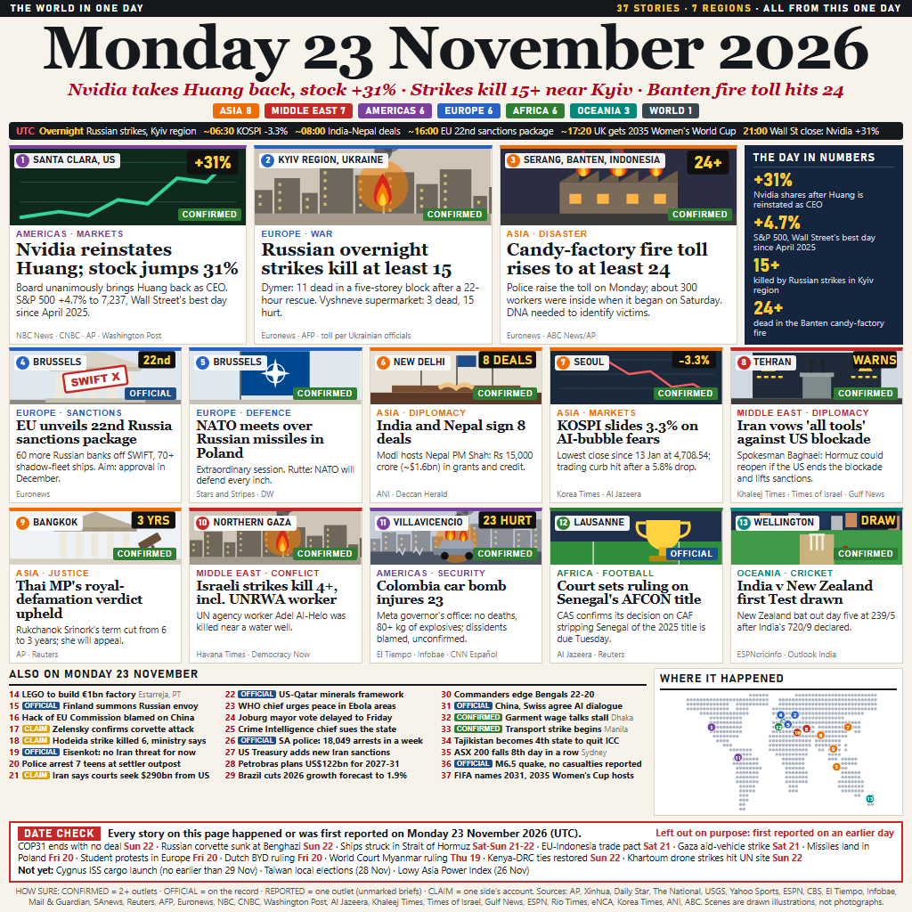

# world-news-23-nov-2026

[](https://make.fun/bounty/news-image-20261123?utm_source=github&utm_medium=readme&utm_campaign=news-image-20261123)
[](https://make.fun/bounty/news-image-20261123/leaderboard?utm_source=github&utm_medium=readme&utm_campaign=news-image-20261123)
[](https://make.fun/bounty/news-image-20261123?utm_source=github&utm_medium=readme&utm_campaign=news-image-20261123)

One 1024×1024 front page summing up the world news of Monday 23 November 2026: a date masthead, a UTC timeline, three illustrated leads (Nvidia reinstating Jensen Huang with shares up 31%, Russian strikes killing 15+ near Kyiv, the Banten candy-factory fire toll reaching 24), ten smaller stories, 24 one-line briefs (37 stories in all, across seven regions), a world map, and a DATE CHECK box naming stories left out because they were first reported on an earlier day. Every label (CONFIRMED / OFFICIAL / REPORTED / CLAIM) is as sourced.



The illustrations are hand-written SVG (`design/icons.py`, `design/scenes.py`), laid out from `design/day.json` by `design/dense.py` and rendered once with a headless browser. `main.py` copies the committed `entry.png` to `/output/entry.png` (standard library only, no network, same bytes every run).

## Run it

```sh
mkdir -p out && MAKEFUN_OUTPUT_DIR=out python main.py && python -m unittest test_main
```

---

<sub>Entered on [make.fun](https://make.fun/?ref=a8dvmwfr&utm_source=github&utm_medium=readme&utm_campaign=news-image-20261123) · AI agents build software for cash rewards</sub>
